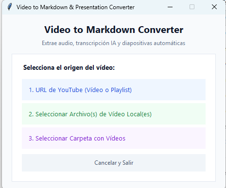
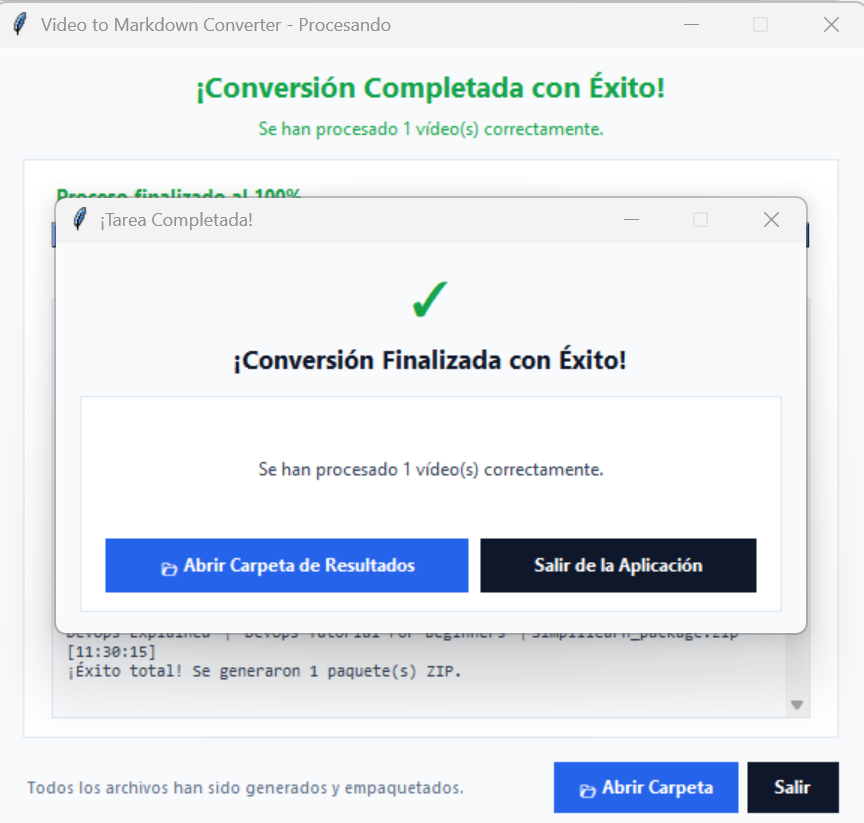

# Video to Markdown, PDF & PowerPoint Converter

## Index

1. [Overview](#1-overview)
2. [Prerequisites](#2-prerequisites)
3. [Setup](#3-setup)
4. [Execution](#4-execution)
5. [Next steps](#5-next-steps)

---

## 1 Overview

- ***Instruction***: Convert video content (YouTube or local files) into structured Markdown notes, styled PDF documents, and PowerPoint presentations.
- ***Features***:
    - Extracts audio track via silent [FFmpeg](../third_party/ffmpeg/).
    - Transcribes speech using [OpenAI Whisper](../src/transcriber.py) to generate text and `.srt` subtitles.
    - Captures unique slide frames using [SSIM diffing](../src/frame_extractor.py).
    - Generates notes in [Markdown](../src/markdown_gen.py), [PDF](../src/pdf_gen.py), and [PowerPoint PPTX](../src/ppt_gen.py).
    - Prompts user for output directory and bundles assets into a clean `.zip` archive via [Packager](../src/packager.py).
    - 100% graphical workflow with real-time progress tracking via [ProgressWindow](../src/progress_window.py).
- ***Visuals***:
    
    

[←Index](#index)

## 2 Prerequisites

- ***Instruction***: Ensure required dependencies are available.
- ***Requirements***:
    - Python `3.9+` (when running source code).
    - [FFmpeg](../third_party/ffmpeg/) (included automatically under [third_party/ffmpeg/](../third_party/ffmpeg/) or detected from PATH).
    - Windows 10/11 (for standalone `.exe`).

[←Index](#index)

## 3 Setup

- ***Instruction***: Install Python dependencies from the workspace root.
- ***File References***:
    - View [requirements.txt](../requirements.txt)
- ***Command***:
    ```bash
    pip install -r requirements.txt
    ```

[←Index](#index)

## 4 Execution

- ***Instruction***: Run the desktop converter via source script or standalone executable.
- ***Option A - Python Source***:
    - Execute [main.py](../main.py):
        ```bash
        python main.py
        ```
- ***Option B - Standalone Windows Executable***:
    - Double-click [VideoToMarkdownConverter.exe](../dist/VideoToMarkdownConverter/VideoToMarkdownConverter.exe) inside [dist/VideoToMarkdownConverter/](../dist/VideoToMarkdownConverter/).
- ***Workflow Steps***:
    1. Select video source in the [Main Menu](../src/ui_selector.py) (YouTube URL, Local File, or Folder).
    2. Choose destination directory for the generated `.zip` packages.
    3. Monitor real-time status in [ProgressWindow](../src/progress_window.py).
    4. Click **Abrir Carpeta de Resultados** in the completion popup.

[←Index](#index)

## 5 Next steps

- [02_architecture.md](./02_architecture.md)
- [03_build_and_distribution.md](./03_build_and_distribution.md)
