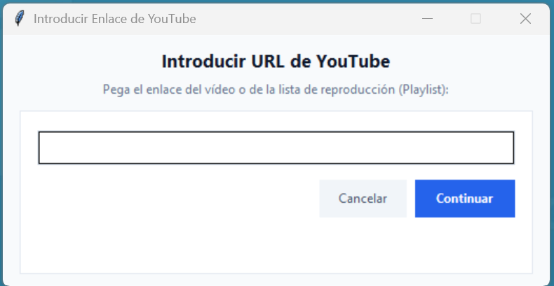
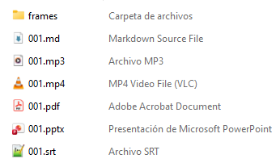

# Guía de Uso: Video to Markdown & Presentation Suite

> **Idioma / Language:** [ 🇪🇸 Español ](./004_user_guide.md) | [ 🇬🇧 English ](./004_user_guide_en.md)

## Index

1. [Inicio de la aplicación](#1-inicio-de-la-aplicacion)
2. [Opción 1: Procesar URL de YouTube](#2-opcion-1-procesar-url-de-youtube)
3. [Opción 2: Procesar archivo(s) de vídeo local(es)](#3-opcion-2-procesar-archivos-de-video-locales)
4. [Opción 3: Procesar carpeta completa de vídeos](#4-opcion-3-procesar-carpeta-completa-de-videos)
5. [Selección de carpeta de destino y ejecución](#5-seleccion-de-carpeta-de-destino-y-ejecucion)
6. [Contenido del paquete de salida](#6-contenido-del-paquete-de-salida)
7. [Siguientes pasos](#7-siguientes-pasos)

---

## 1 Inicio de la aplicación

- ***Instruction***: Ejecuta la suite de escritorio desde el ejecutable compilado o mediante Python.
    - Ejecutable: Abre [dist/VideoToMarkdownConverter/VideoToMarkdownConverter.exe](../dist/VideoToMarkdownConverter/VideoToMarkdownConverter.exe).
    - Script: Ejecuta `python main.py` desde la raíz del proyecto.
- ***Ayuda integrada***: Pulsa el botón inferior **📖 Guía de uso** en la ventana principal para abrir esta documentación en cualquier momento.
- ***Visuals***:
    
- ***File References***:
    - Punto de entrada: [main.py](../main.py)
    - Selector gráfico: [src/ui_selector.py](../src/ui_selector.py)

[←Index](#index)

---

## 2 Opción 1: Procesar URL de YouTube

- ***Instruction***: Pulsa el botón **1. URL de YouTube (Vídeo individual o Lista de reproducción)**.
- ***Steps***:
    1. Introduce o pega el enlace en la casilla de texto.
    2. Haz clic derecho para acceder al menú contextual (**Pegar**, **Copiar**, **Cortar**, **Seleccionar todo**).
    3. Pulsa **Continuar** (o presiona la tecla `Enter`).
    4. Si el enlace pertenece a una lista de reproducción (*Playlist*), confirma si deseas procesar la lista entera o únicamente el vídeo seleccionado.
- ***Visuals***:
    
- ***File References***:
    - Gestor de descargas yt-dlp: [src/input_handler.py](../src/input_handler.py)

[←Index](#index)

---

## 3 Opción 2: Procesar archivo(s) de vídeo local(es)

- ***Instruction***: Pulsa el botón **2. Seleccionar Archivo(s) de Vídeo Local(es)**.
- ***Steps***:
    1. En la ventana del explorador de Windows, navega hasta tus archivos de vídeo.
    2. Selecciona uno o varios vídeos simultáneamente manteniendo pulsada la tecla `Ctrl` o `Shift`.
    3. Formatos compatibles: `.mp4`, `.mkv`, `.avi`, `.mov`, `.webm`.
    4. Pulsa **Abrir**.
- ***File References***:
    - Normalizador de formatos FFmpeg: [src/converter.py](../src/converter.py)

[←Index](#index)

---

## 4 Opción 3: Procesar carpeta completa de vídeos

- ***Instruction***: Pulsa el botón **3. Seleccionar Carpeta con Vídeos (Lotes)**.
- ***Steps***:
    1. Selecciona la carpeta contenedora donde residen tus grabaciones o lecciones.
    2. Pulsa **Seleccionar carpeta**.
    3. La aplicación analizará recursivamente la carpeta y procesará en lote todos los vídeos compatibles de forma secuencial.
- ***File References***:
    - Gestor de entradas: [src/input_handler.py](../src/input_handler.py)

[←Index](#index)

---

## 5 Selección de carpeta de destino y ejecución

- ***Instruction***: Tras seleccionar los vídeos de entrada, elige la carpeta de salida y monitoriza el avance.
- ***Steps***:
    1. Selecciona la carpeta donde deseas guardar los paquetes finales `.zip`.
    2. La **Ventana de Progreso** iniciará el procesamiento multihilo automático:
       - Extracción de audio MP3.
       - Transcripción sincronizada con Whisper AI.
       - Detección de diapositivas mediante visión artificial (SSIM).
       - Generación de Markdown, PDF y presentación PowerPoint.
       - Empaquetado en `.zip` y purga de archivos temporales.
    3. Al finalizar, la ventana flotante modal **¡Tarea Completada!** bloqueará la pantalla y ofrecerá acceso directo mediante **📂 Abrir Carpeta de Resultados** o **Salir de la Aplicación**.
- ***Visuals***:
    
- ***File References***:
    - Ventana de progreso y modal: [src/progress_window.py](../src/progress_window.py)

[←Index](#index)

---

## 6 Contenido del paquete de salida

- ***Instruction***: Descomprime el archivo `.zip` generado para acceder a todo el material estructurado.
- ***Visuals***:
    
- ***Componentes generados***:
    - `frames/`: Carpeta con todas las capturas de pantalla de diapositivas extraídas.
    - `001.md`: Documento Markdown con el contenido transcrito y las capturas enlazadas.
    - `001.pdf`: Documento PDF maquetado con imágenes incrustadas.
    - `001.pptx`: Presentación PowerPoint con la captura a la izquierda y el texto a la derecha.
    - `001.mp3`: Pista de audio extraída del vídeo original.
    - `001.srt`: Subtítulos con marcas de tiempo sincronizadas.
    - `001.mp4`: Vídeo normalizado en formato estándar reproducible.
- ***File References***:
    - Empaquetador ZIP: [src/packager.py](../src/packager.py)
    - Generador Markdown: [src/markdown_gen.py](../src/markdown_gen.py)
    - Generador PDF: [src/pdf_gen.py](../src/pdf_gen.py)
    - Generador PowerPoint: [src/ppt_gen.py](../src/ppt_gen.py)

[←Index](#index)

---

## 7 Siguientes pasos

- [001_overview.md](./001_overview.md)
- [002_architecture.md](./002_architecture.md)
- [003_build_and_distribution.md](./003_build_and_distribution.md)
- [README.md](../README.md)
